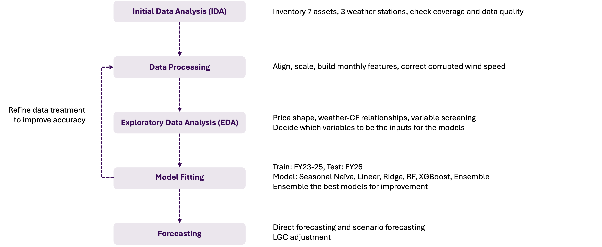
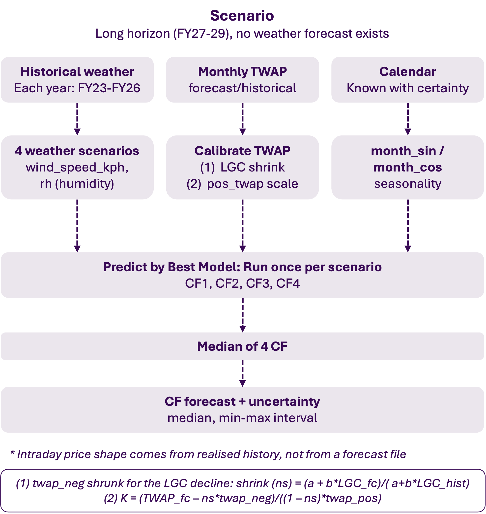

```{python}
#| include: false
# Project functions (functions/utilsPlot.py: dictionary_table builds the data-dictionary tables from data/dictionary/*.csv)
import os, sys
sys.path.insert(0, os.path.join(os.getcwd(), "functions"))
from utilsPlot import dictionary_table
```

# Background {background-image="images/title_background.jpg" background-size="cover"}

<p class="section-note">What the contract factor is, how the current TWAP-based model forecasts it and where it falls short, and our end-to-end workflow.</p>

## What is Contract Factor?

::: {style="width: 604px; margin-top: 22px;"}
**What is Contract Factor and why is it important?**

-   Wind and solar farms do not generate evenly, and the market price changes every 5 minute so the average price a farm earns is not the same as the average market price.
-   Contract Factor (CF) compares the two: the higher the CF, the more the farm earns per MWh compared with the market average. The price a farm earns is measured the way SEC's VRET contracts pay: never below \$0, so negative prices count as \$0.
-   SEC uses CF to forecast the revenue of its VRET wind and solar assets in the Corporate Model.

**How Analytics defines and calculates CF for VRET wind and solar assets**

::: {.formula style="margin: 8px 0 6px 0;"}
$$\text{AssetDWAP} = \frac{\sum \big(\text{AssetOutput [MWh]} \times \max(\text{VIC1Price}, 0)\ [\$/\text{MWh}]\big)}{\sum \text{AssetOutput [MWh]}}$$
:::

::: {.formula style="margin: 0 0 12px 0;"}
$$\text{AssetCF} = \frac{\text{AssetDWAP}}{\text{AssetTWAP}}$$
:::

-   DWAP: average price weighted by the asset's output, negative prices floored at \$0
-   TWAP: average market price over the period
-   CF is calculated for each month from 30-minute data.

We use monthly CF throughout, because SEC calculates CF monthly, our price, LGC and weather inputs are monthly, and daily or weekly CF is much noisier.
:::

::: {.abs .fig style="left: 651px; top: 81px; width: 593px;"}

:::

## The recent CF forecasting model

::: {style="width: 620px; margin-top: 12px;"}
Exponential relationships fit between VIC1Price TWAP and CF, separately for each season

-   For wind, the model captures a clear negative CF-TWAP relationship in summer, autumn and spring, but over-predicts the FY26 test months (MAE 0.31-0.36); winter is flat and fits well (0.052)
-   For solar, the relationships are weak and the autumn curve extrapolates to implausible values.
-   So TWAP alone is not reliable.

**Our approach: This project extends the current model in two ways.**

-   **Weather:** Capture performance depends on whether generation happens in the hours when prices are good. The current model has no information about when generation happens, so we introduce weather variables (irradiance, wind speed, temperature, humidity) as explanatory features.
-   **Certificate price (LGC):** Historical negative prices were shaped by a certificate worth up to \$66. It is worth about \$8 today and the scheme ends in 2030, so the price structure has to be corrected before it can be used to forecast forward.
:::

::: {.abs .fig style="left: 668px; top: 47px; width: 490px;"}

:::

## End-to-End Modelling Workflow

<div class="center-fig"></div>

# Data {background-image="images/title_background.jpg" background-size="cover"}

<p class="section-note">The seven VRET assets and three weather stations we use, and the candidate variables for the wind CF model.</p>

## Assets & Stations

```{python}
dictionary_table("data/dictionary/assets_stations.csv")
```

<p class="foot">We model CF at portfolio level (wind and solar), not asset by asset</p>

## Variables - WIND CF Model

```{python}
dictionary_table('data/dictionary/variables_wind.csv')
```

<p class="foot">\(1\) Monthly mean TWAP includes both positives and negatives</p>

# Feature selection {background-image="images/title_background.jpg" background-size="cover"}

<p class="section-note">Which variables enter the wind model, chosen from their correlation with CF and checked for multicollinearity.</p>

## Feature selection - WIND Model

::: {style="width: 509px; margin-top: 8px;"}
-   For Wind, we kept the variables most correlated with WIND_CF (twap_neg −0.84, month_cos 0.81, rh −0.60, wind_speed_kph as the physical driver) and dropped redundant ones (twap, temp_c, dp_c) and uncorrelated ones (rainfall_mm).
-   We then checked multicollinearity with VIF to confirm the final six inputs do not overlap.
-   **Wind features: wind_speed_kph, twap_neg, twap_pos, rh, month_sin, month_cos**
:::

::: {.abs .fig style="left: 544px; top: 38px; width: 660px;"}

:::

# Price structure & LGC {background-image="images/title_background.jpg" background-size="cover"}

<p class="section-note">Why negative prices raise CF, and how replayed historical prices are adjusted for a cheaper certificate (LGC).</p>

## Negative prices and the certificate that sets their floor

-   FY26: **26%** of half-hours below \$0, up from **20%** in FY23, and **56%** of them sit in the shallow −\$10 to \$0 band
-   Why: **Supply and demand decide when prices go negative. The certificate decides how deep.**
-   LGC = one certificate per MWh of renewable generation; retailers are legally required to buy them; scheme ends 31 Dec 2030
-   LGC fell from \~\$32 (FY25 avg) to \~\$6 by Jun 2026 (**−82%**), so the floor has lifted toward zero and negative prices are getting shallower

::: {.abs .fig style="left: 36px; top: 245px; width: 589px;"}

:::
::: {.abs .fig style="left: 655px; top: 245px; width: 589px;"}

:::

## Adjusting replayed prices for a cheaper certificate

<div class="bul" style="left: 36px; top: 59px; width: 1208px;"><b>The problem:</b> Our long-horizon forecast reuses the monthly price structure (negative TWAP, positive TWAP, negative share) of past years. FY23–24 had a certificate around \$50, so their negative prices were far deeper than FY27–29 will see (LGC ~\$8). Replaying that structure unchanged overstates the zero-dollar-floor benefit in CF.</div>

<div class="bul" style="left: 36px; top: 132px;"><b>Step 1: Shrink the negative half-hours</b></div>
::: {.abs .formula style="left: 76px; top: 156px;"}
$$P'_t = \begin{cases} s \cdot P_t & P_t < 0 \\ P_t & P_t \ge 0 \end{cases} \qquad s = \frac{a + b\,\text{LGC}_{\text{target}}}{a + b\,\text{LGC}_{\text{hist}}}, \qquad s \in [0, 1]$$
:::
<div class="abs" style="left: 69px; top: 226px; font-size: 14px; line-height: 1.3;">depth = how deep a month's negatives go = −(5th percentile of price)<br><i>s</i> = predicted depth at the target LGC / predicted depth at the historical LGC<br><i>a</i> = depth that exists with no certificate at all (averaged over the year)<br><i>b</i> = extra dollars of depth per dollar of certificate</div>

<div class="bul" style="left: 36px; top: 304px;"><b>Step 2: Rescale the positive half-hours so the month still matches the forecasted price</b></div>
::: {.abs .formula style="left: 97px; top: 324px;"}
$$P''_t = \begin{cases} P'_t & P_t < 0 \\ k \cdot P'_t & P_t \ge 0 \end{cases} \qquad k = \frac{\text{TWAP}_{\text{target}} - n_s\,\bar{P}'_{\text{neg}}}{(1 - n_s)\,\bar{P}_{\text{pos}}}$$
:::
<div class="abs" style="left: 94px; top: 398px;">Note that:</div>
::: {.abs .formula style="left: 98px; top: 420px;"}
$$\text{TWAP} = n_s\,\bar{P}_{\text{neg}} + (1 - n_s)\,\bar{P}_{\text{pos}}$$
:::

<div class="bul" style="left: 36px; top: 461px;"><b>Example:</b> replaying January 2023 into January 2028</div>
::: {.abs style="left: 280px; top: 493px;"}

:::

# Modelling & forecasting {background-image="images/title_background.jpg" background-size="cover"}

<p class="section-note">How the FY27-29 scenario forecast is built, and the baselines and models we compare.</p>

## Forecasting Method

<div class="center-fig"></div>

## Model Summary

```{python}
dictionary_table('data/dictionary/model_summary.csv', bold_cols=1, css_class='dd models')
```

# Results {background-image="images/title_background.jpg" background-size="cover"}

<p class="section-note">Every model tested on FY26 against the actual CF, and a closer look at the best wind models.</p>


## WIND CF Overview

<p class="sub">Training set: FY23-25, Test set: FY26. Model comparison using MAE</p>

::: {.abs .fig style="left: 36px; top: 100px; width: 745px;"}

:::

::: {.abs .mae-box style="left: 840px; top: 118px; width: 404px;"}

:::

::: {.abs style="left: 36px; top: 548px; width: 1208px;"}
-   Ensemble, XGBoost and Ridge are the most accurate (MAE 0.085-0.090), and the gap between them is small
-   All models beat both baselines but miss the October trough. Ridge reaches the December peak but over-predicts October-November.
-   Choose best 3 models
:::


## WIND CF Best models

<div class="abs subhead" style="left: 36px; top: 64px;">Feature importance</div>

::: {.abs .fig style="left: 36px; top: 96px; width: 1208px;"}

:::

<div class="abs subhead" style="left: 36px; top: 356px;">Test FY26</div>

::: {.abs .fig style="left: 36px; top: 386px; width: 630px;"}

:::

::: {.abs .box style="left: 690px; top: 420px; width: 554px;"}
**Key takeaway:**

-   Both models rely mostly on twap_neg and month_cos: deeper negative prices and summer months give a higher CF
-   Weather inputs contribute much less than price
-   Both models track the seasonal cycle of actual CF but miss month-specific swings.
:::


# Conclusion {background-image="images/title_background.jpg" background-size="cover"}

<p class="section-note">Key findings, limitations and suggestions for the next steps.</p>

## Summary, limitations and suggestions


# Appendix {background-image="images/title_background.jpg" background-size="cover"}

<p class="section-note">Calibration of the corrupted wind speed data, the solar CF model, and feature imporance and the FY27-29 forecast of every model.</p>

## Abbreviations

```{python}
dictionary_table('data/dictionary/abbreviations.csv', bold_cols=[0, 2], css_class='dd abbr')
```

## Data sources

```{python}
dictionary_table('data/dictionary/data_sources.csv', bold_cols=1)
```

## Exclusion periods

::: {style="margin-top: 4px;"}
-   **Exclusion periods** (`ExclusionPeriods.csv`, SEC) are the days an asset's output does not count under its contract, for example outages or commissioning. Their half-hours are set to missing before the CF is computed, so a monthly CF uses only the available half-hours.
-   The longest are BULGANA1 (Jun 2024 - Dec 2025, 578 days) and COHUNSF1 (Mar 2024 - Apr 2025, 376 days); MRTLSWF1 and GLENSF1 came online during the window (light grey).
:::

::: {.abs .fig style="left: 140px; top: 168px; width: 1000px;"}

:::

## Calibrate data: Wind_speed_kph

::: {.abs .box .qm-box style="left: 36px; top: 112px; width: 540px; min-height: 170px;"}
-   DTN wind speed data for stations 89002 & 86338 suffered systematic amplitude compression from 7/10/2025 – 14/4/2026 (6 months, 9,120 half-hours)
-   Critically, **temporal rank order is preserved**: Spearman correlation with actual generation barely changed (89002: 0.488 → 0.475; 86338: 0.337 → 0.356). This means the signal is recoverable.
:::

::: {.abs .box .qm-box style="left: 36px; top: 440px; width: 540px; min-height: 170px;"}
**⇒ Correction method - Quantile Mapping (QM):** a standard technique in meteorology for bias-correcting climate data. Each corrupted value is mapped to the same percentile in the clean historical distribution, stratified by (month x half-hour of day) to respect seasonal and diurnal wind patterns. Reference period: Oct-Apr of FY23-25 (3 clean years)
:::

::: {.abs .fig style="left: 650px; top: 26px; width: 545px;"}

:::

::: {.abs .fig style="left: 650px; top: 370px; width: 545px;"}

:::

## Variables - SOLAR CF Model

```{python}
dictionary_table('data/dictionary/variables_solar.csv')
```

## Feature selection - SOLAR Model

::: {style="width: 509px; margin-top: 8px;"}
-   For Solar, only twap_neg is clearly linked to SOLAR_CF (r −0.40); the weather variables are weakly correlated (|r| ≤ 0.11), so the price structure drives solar CF more than the sunshine itself.
-   We kept ghi as the physical driver and dropped redundant variables: dni (r 0.91 with ghi), air_temp_c (r 0.89 with ghi; tested and did not lower the forecast error) and twap (r 0.98 with twap_pos).
-   VIF flags ghi and month_cos (VIF ≈ 22, r 0.95): both follow the seasons. We keep both, because RF, the model used for the forecast, is not affected by correlated inputs, and Ridge shrinks them.
-   **Solar features: ghi, twap_neg, twap_pos, month_sin, month_cos**
:::

::: {.abs .fig style="left: 560px; top: 38px; width: 640px;"}

:::


## Result for SOLAR CF - Overview

<p class="sub">Training set: FY23-25, Test set: FY26. Model comparison using MAE</p>

::: {.abs .fig style="left: 36px; top: 100px; width: 745px;"}

:::

::: {.abs .mae-box style="left: 840px; top: 118px; width: 404px;"}

:::

::: {.abs style="left: 36px; top: 548px; width: 1208px;"}
-   RF, Ensemble and XGBoost are the most accurate (MAE 0.123-0.133) and the only models that beat the Seasonal Naive baseline (0.152)
-   The linear models do not beat Seasonal Naive (Ridge 0.192, Linear 0.201): they predict an almost flat CF and miss the seasonal swings
-   All models miss the November trough (actual CF 0.18) and the June peak (0.99).
:::


## Result for SOLAR CF - Best Tree vs Best Linear models

<div class="abs subhead" style="left: 36px; top: 64px;">Feature importance</div>

::: {.abs .fig style="left: 36px; top: 96px; width: 1208px;"}

:::

<div class="abs subhead" style="left: 36px; top: 356px;">Test FY26</div>

::: {.abs .fig style="left: 36px; top: 386px; width: 630px;"}

:::

::: {.abs .box style="left: 690px; top: 396px; width: 554px;"}
**Key takeaway:**

-   Both models rely mostly on twap_neg: deeper negative prices give a higher CF. It is the only significant Ridge coefficient (p < 0.001)
-   ghi is the second input of RF (share 0.31) but not significant in Ridge (p = 0.16): its effect on CF is not a straight line
-   RF follows the seasonal cycle of actual CF; Ridge stays almost flat (0.37-0.46) and misses the swings
-   Ridge's band is wider than RF's (Sep-Dec) but stays flat around 0.4: it only catches the low CF of Sep-Oct, while RF's narrow band sits on the actual CF in Jul-Aug and Dec-Feb
:::


## MAE by model (FY26 test)

::: {.abs .fig style="left: 36px; top: 90px; width: 595px;"}

:::

::: {.abs .fig style="left: 650px; top: 90px; width: 595px;"}

:::

## Error metrics (FY26 test)

::: {.abs .tbl-box .tbl-wide style="left: 36px; top: 70px; width: 1208px;"}
<div class="subhead">WIND</div>

:::

::: {.abs .tbl-box .tbl-wide style="left: 36px; top: 380px; width: 1208px;"}
<div class="subhead">SOLAR</div>

:::

## Feature importance of every model - WIND

::: {.abs .fig style="left: 86px; top: 70px; width: 1108px;"}

:::

## Feature importance of every model - SOLAR

::: {.abs .fig style="left: 86px; top: 70px; width: 1108px;"}

:::

## Linear and Ridge fit: coefficients and checks

::: {.abs .tbl-box style="left: 36px; top: 64px; width: 590px;"}
<div class="subhead">WIND</div>

:::

::: {.abs .tbl-box style="left: 654px; top: 64px; width: 590px;"}
<div class="subhead">SOLAR</div>

:::

## Exponential baseline vs the best model (FY26 test)

::: {.abs .fig style="left: 60px; top: 66px; width: 540px;"}

:::

::: {.abs .fig style="left: 680px; top: 66px; width: 540px;"}

:::

## FY27-29 forecast of every model - WIND

::: {.abs .fig style="left: 36px; top: 80px; width: 1208px;"}

:::

## FY27-29 forecast of every model - SOLAR

::: {.abs .fig style="left: 36px; top: 80px; width: 1208px;"}

:::
